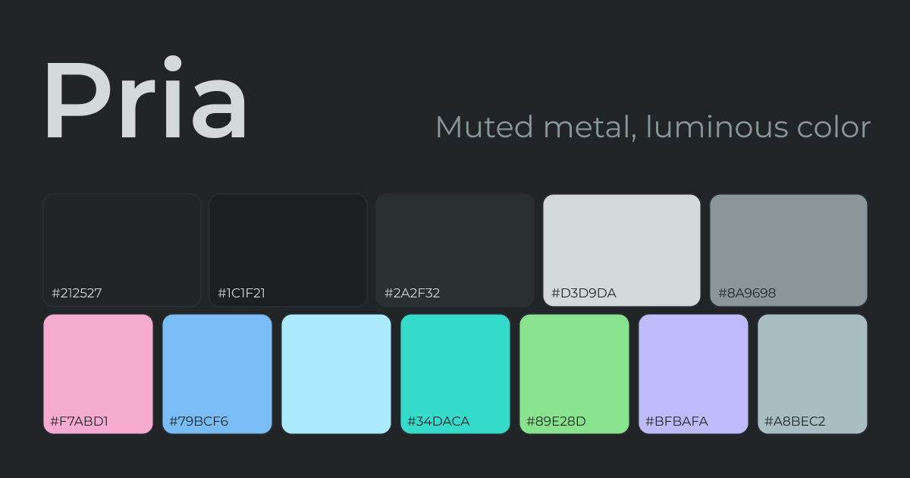
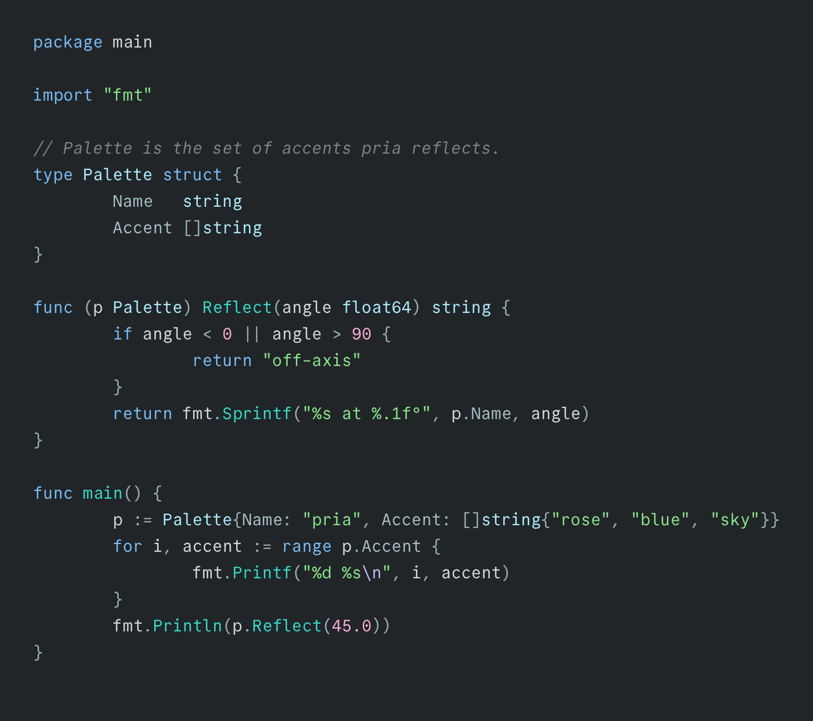

A dark colorscheme for Neovim and the terminal, built around the reflection of light on metal.

## Syntax Highlight



## Ports

<details open>
<summary>Neovim</summary>

### lazy.nvim

```lua
{
  "nnavales/paragon.nvim",
  lazy = false,
  priority = 1000,
  config = function()
    vim.cmd.colorscheme("pria")
  end,
}
```

### Extended configuration

`setup()` is only needed when you want to change the defaults. Call it before applying the theme.

```lua
require("pria").setup({
  transparent = false,                -- Disable background color (use terminal background)
  dim = true,                         -- Dim inactive windows
  borders = true,                     -- Show borders around floating windows and popups
  terminal_colors = true,             -- Set Neovim terminal colors
  styles = {                          -- Syntax element styles
    keywords = {},                    -- if, for, return, break, continue
    functions = {},                   -- foo(), bar(), method calls
    types = {},                       -- class, struct, int, enum
    comments = { italic = false },    -- Line and block comments
    builtins = { italic = true },     -- Built-in variables (self, this, super)
  },
  plugins = {                         -- Plugin highlight groups
    telescope = false,                -- Disable the Telescope group
  },
})

vim.cmd.colorscheme("pria")
```

Each style accepts attributes such as `bold`, `italic`, and `underline`.

Lualine themes are included: use `pria` or `pria_transparent`.

</details>

<details>
<summary>bat</summary>

Theme: [`extra/bat/pria.tmTheme`](extra/bat/pria.tmTheme)

```bash
mkdir -p "$(bat --config-dir)/themes"
cp extra/bat/pria.tmTheme "$(bat --config-dir)/themes/"
bat cache --build
```

Add `--theme="pria"` to your bat config.

</details>

<details>
<summary>btop</summary>

Theme: [`extra/btop/pria.theme`](extra/btop/pria.theme)

```bash
mkdir -p "${XDG_CONFIG_HOME:-$HOME/.config}/btop/themes"
cp extra/btop/pria.theme "${XDG_CONFIG_HOME:-$HOME/.config}/btop/themes/"
```

Select the theme from btop's menu (`F2`).

</details>

<details>
<summary>delta</summary>

Config: [`extra/delta/pria.gitconfig`](extra/delta/pria.gitconfig)

Install the bat port first (`extra/bat/pria.tmTheme`), then include the delta config:

```bash
git config --global include.path "$PWD/extra/delta/pria.gitconfig"
```

</details>

<details>
<summary>eza</summary>

Theme: [`extra/eza/theme.yml`](extra/eza/theme.yml)

```bash
mkdir -p ~/.config/eza
cp extra/eza/theme.yml ~/.config/eza/theme.yml
```

</details>

<details>
<summary>fzf</summary>

Theme: [`extra/fzf/pria.sh`](extra/fzf/pria.sh)

Source the snippet from your shell startup file:

```bash
source /path/to/pria/extra/fzf/pria.sh
```

The current snippet targets Bash and Zsh.

</details>

<details>
<summary>herdr</summary>

Theme: [`extra/herdr/pria.toml`](extra/herdr/pria.toml)

Merge the `[theme]` block into `~/.config/herdr/config.toml`, replacing any existing `[theme]` block, then reload:

```bash
herdr server reload-config
```

</details>

<details>
<summary>kitty</summary>

Theme: [`extra/kitty/pria.conf`](extra/kitty/pria.conf)

```bash
mkdir -p ~/.config/kitty/themes
cp extra/kitty/pria.conf ~/.config/kitty/themes/
```

Add this to `kitty.conf`:

```conf
include themes/pria.conf
```

</details>

<details>
<summary>opencode</summary>

Theme: [`extra/opencode/pria.json`](extra/opencode/pria.json)

```bash
mkdir -p ~/.config/opencode/themes
cp extra/opencode/pria.json ~/.config/opencode/themes/
```

Select **Pria** from OpenCode's theme selector.

</details>

<details>
<summary>vim</summary>

Theme: [`extra/vim/pria.vim`](extra/vim/pria.vim)

```bash
mkdir -p ~/.vim/colors
cp extra/vim/pria.vim ~/.vim/colors/
```

```vim
colorscheme pria
```

</details>

## Colors

### Core palette

| Color    | Hex       | Purpose                                  |
| -------- | --------- | ---------------------------------------- |
| `bg`     | `#212527` | Main background                          |
| `bg2`    | `#1C1F21` | Recessed surfaces: floats and popups     |
| `bg3`    | `#2A2F32` | Raised surfaces, separators, and borders |
| `fg`     | `#D3D9DA` | Main text                                |
| `fg2`    | `#8A9698` | Secondary text                           |
| `rose`   | `#F7ABD1` | Numbers, booleans, and literals          |
| `blue`   | `#79BCF6` | Keywords and links                       |
| `sky`    | `#ACEAFE` | Types and titles                         |
| `cyan`   | `#34DACA` | Functions and methods                    |
| `green`  | `#89E28D` | Strings and additions                    |
| `lilac`  | `#BFBAFA` | Decorators and search                    |
| `silver` | `#A8BEC2` | Members and attributes                   |

<details>
<summary>Interface colors</summary>

| Color        | Hex       | Purpose                                                |
| ------------ | --------- | ------------------------------------------------------ |
| `comment`    | `#798486` | Comments                                               |
| `faint`      | `#464D4F` | Line numbers, disabled text, and non-text UI           |
| `structure`  | `#97ADB1` | Operators, delimiters, and separators                  |
| `selection`  | `#394B5B` | Visual selection, picker selection, and LSP references |
| `search`     | `#BFBAFA` | Search matches                                         |
| `search_bg`  | `#343740` | Search match background                                |
| `substitute` | `#BFBAFA` | Substitute highlight                                   |
| `match`      | `#BFBAFA` | Matching brackets and picker matches                   |
| `title`      | `#ACEAFE` | Float, picker, and section titles                      |
| `yellow`     | `#E3B341` | Warnings and special states                            |
| `orange`     | `#ECA25C` | Icons                                                  |
| `red`        | `#FF7A7A` | Errors and deletions                                   |
| `success`    | `#89E28D` | Success messages and health checks                     |
| `warning`    | `#E3B341` | Warnings                                               |
| `error`      | `#FF7A7A` | Errors                                                 |
| `info`       | `#79BCF6` | Informational messages                                 |
| `hint`       | `#ACEAFE` | Hints and TODOs                                        |

</details>

<details>
<summary>Diff, git, and diagnostics</summary>

| Color                | Hex                   | Purpose                              |
| -------------------- | --------------------- | ------------------------------------ |
| `git.add`            | `#89E28D`             | Added files                          |
| `git.change`         | `#ACEAFE`             | Modified files                       |
| `git.delete`         | `#FF7A7A`             | Deleted files                        |
| `diff.add`           | `#313F37`             | Added diff lines                     |
| `diff.change`        | `#2E3A44`             | Changed diff lines                   |
| `diff.delete`        | `#413334`             | Deleted diff lines                   |
| `diff.text`          | `#33434F`             | Changed text within a diff           |
| `diagnostic.error`   | `#E9A8A6` / `#463535` | Error chip foreground / background   |
| `diagnostic.warning` | `#D8C495` / `#403C30` | Warning chip foreground / background |
| `diagnostic.info`    | `#A7C7E4` / `#303D48` | Info chip foreground / background    |
| `diagnostic.hint`    | `#C3E2EC` / `#374448` | Hint chip foreground / background    |

</details>

Terminal colors are generated from the same palette.

## MIT

MIT © 2026 Nahuel Navales
